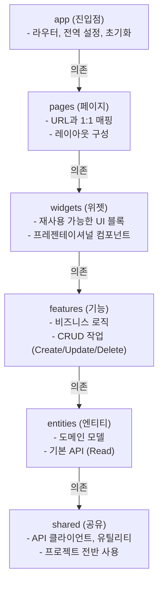

# 디자인 규칙 가이드

## 목차
1. [프로젝트 구조 패턴](#프로젝트-구조-패턴)
2. [컴포넌트 설계 원칙](#컴포넌트-설계-원칙)
3. [상태 관리 패턴](#상태-관리-패턴)
4. [API 레이어 설계](#api-레이어-설계)
5. [에러 처리 전략](#에러-처리-전략)
6. [라우팅 구조](#라우팅-구조)

---

## 프로젝트 구조 패턴

### FSD (Feature-Sliced Design) 아키텍처

이 프로젝트는 FSD 아키텍처를 기반으로 설계되었습니다.



### 의존성 규칙

1. **단방향 의존성**: 하위 레이어는 상위 레이어를 알지 못함
2. **수평 의존성 금지**: 같은 레이어 내 다른 모듈에 의존하지 않음
3. **예외**: `shared`는 모든 레이어에서 import 가능

```typescript
// ✅ 좋음: 상위 → 하위 의존
// pages에서 features, entities 사용
import { createCompetition } from '@/features';
import { Competition } from '@/entities';

// ❌ 나쁨: 하위 → 상위 의존
// entities에서 features 사용 (불가능)
import { createCompetition } from '@/features'; // ❌

// ❌ 나쁨: 수평 의존
// features/competition에서 features/round 사용 (불가능)
import { createRound } from '@/features/round'; // ❌
```

---

## 컴포넌트 설계 원칙

### 1. 단일 책임 원칙 (SRP)

각 컴포넌트는 하나의 책임만 가져야 합니다.

```typescript
// ❌ 나쁨: 너무 많은 책임
const CompetitionPage = () => {
  // 데이터 페칭
  const [competitions, setCompetitions] = useState([]);
  const [loading, setLoading] = useState(false);
  
  // 폼 상태
  const [formData, setFormData] = useState({});
  
  // 렌더링
  return (
    <div>
      {/* 목록 표시 */}
      {/* 폼 표시 */}
      {/* 필터 표시 */}
    </div>
  );
};

// ✅ 좋음: 책임 분리
const CompetitionPage = () => {
  return (
    <div>
      <CompetitionFilter />
      <CompetitionList />
      <CompetitionForm />
    </div>
  );
};
```

### 2. 컨테이너/프레젠테이셔널 패턴

```typescript
// 프레젠테이셔널 컴포넌트 (UI만 담당)
interface CompetitionCardProps {
  competition: Competition;
  onSelect: (idx: number) => void;
}

const CompetitionCard = ({ competition, onSelect }: CompetitionCardProps) => {
  return (
    <div onClick={() => onSelect(competition.idx)}>
      <h3>{competition.compName}</h3>
      <p>{competition.location}</p>
    </div>
  );
};

// 컨테이너 컴포넌트 (로직 담당)
const CompetitionListContainer = () => {
  const [competitions, setCompetitions] = useState<Competition[]>([]);
  const [loading, setLoading] = useState(false);
  
  useEffect(() => {
    loadCompetitions();
  }, []);
  
  const loadCompetitions = async () => {
    setLoading(true);
    try {
      const data = await getCompetitions();
      setCompetitions(data.content);
    } catch (error) {
      console.error(error);
    } finally {
      setLoading(false);
    }
  };
  
  const handleSelect = (idx: number) => {
    // 선택 로직
  };
  
  if (loading) return <div>로딩중...</div>;
  
  return (
    <div>
      {competitions.map(comp => (
        <CompetitionCard 
          key={comp.idx} 
          competition={comp} 
          onSelect={handleSelect}
        />
      ))}
    </div>
  );
};
```

### 3. 커스텀 훅 활용

반복되는 로직은 커스텀 훅으로 추출합니다.

```typescript
// 커스텀 훅
const useCompetitions = () => {
  const [competitions, setCompetitions] = useState<Competition[]>([]);
  const [loading, setLoading] = useState(false);
  const [error, setError] = useState<string | null>(null);
  
  const load = async (params?: PageQuery) => {
    setLoading(true);
    setError(null);
    try {
      const data = await getCompetitions(params);
      setCompetitions(data.content);
    } catch (err) {
      setError(err instanceof Error ? err.message : '알 수 없는 에러');
    } finally {
      setLoading(false);
    }
  };
  
  return { competitions, loading, error, load };
};

// 사용
const CompetitionPage = () => {
  const { competitions, loading, error, load } = useCompetitions();
  
  useEffect(() => {
    load();
  }, []);
  
  return (
    <div>
      {loading && <div>로딩중...</div>}
      {error && <div>{error}</div>}
      {competitions.map(comp => (
        <CompetitionCard key={comp.idx} competition={comp} />
      ))}
    </div>
  );
};
```

---

## 상태 관리 패턴

### 1. 로컬 상태 (useState)

컴포넌트 내부에서만 사용되는 상태는 로컬 상태로 관리합니다.

```typescript
const CompetitionForm = () => {
  const [formData, setFormData] = useState({
    compName: '',
    location: '',
  });
  
  const handleChange = (field: string, value: string) => {
    setFormData(prev => ({ ...prev, [field]: value }));
  };
  
  return (
    <form>
      <input 
        value={formData.compName}
        onChange={(e) => handleChange('compName', e.target.value)}
      />
    </form>
  );
};
```

### 2. API 상태 패턴

API 호출 상태는 일관된 패턴으로 관리합니다.

```typescript
const CompetitionPage = () => {
  // 데이터 상태
  const [competitions, setCompetitions] = useState<Competition[]>([]);
  
  // UI 상태
  const [loading, setLoading] = useState(false);
  const [error, setError] = useState<string | null>(null);
  const [result, setResult] = useState<string | null>(null);
  
  // API 핸들러 생성
  const apiHandler = createApiHandler(setLoading, setError, setResult);
  
  // API 호출
  const handleCreate = async (data: CreateCompetitionRequest) => {
    await apiHandler(
      () => createCompetition(data),
      '대회가 생성되었습니다.'
    );
  };
  
  return (
    <div>
      {loading && <div>처리중...</div>}
      {error && <div className="error">{error}</div>}
      {result && <div className="success">{result}</div>}
    </div>
  );
};
```

### 3. 인증 상태 관리

인증 관련 상태는 localStorage와 axios interceptor로 관리합니다.

```typescript
// 토큰 저장
localStorage.setItem('access_token', token);
localStorage.setItem('refresh_token', refreshToken);

// 토큰 삭제
localStorage.removeItem('access_token');
localStorage.removeItem('refresh_token');

// axios interceptor에서 자동으로 토큰 추가
// src/shared/api/base.ts 참조
```

---

## API 레이어 설계

### 1. 3계층 구조

```
┌────────────────────────────────┐
│    API 함수 (getCompetition)   │  ← features/pages에서 호출
│    - 비즈니스 로직             │
└────────────────────────────────┘
              ↓
┌────────────────────────────────┐
│    Mapper (CompetitionMapper)  │  ← DTO를 Model로 변환
│    - 데이터 변환               │
└────────────────────────────────┘
              ↓
┌────────────────────────────────┐
│    ApiClient (base.ts)         │  ← HTTP 통신
│    - axios 래퍼                │
└────────────────────────────────┘
```

### 2. Entity API 패턴 (Read)

Entity는 기본적인 Read 작업만 담당합니다.

```typescript
// src/entities/competition/api/getCompetition.ts
import { apiClient } from '@/shared/api/base';
import type { CompetitionDTO } from './dto/competition.dto';
import type { Page } from '@/shared/model/page';
import { CompetitionMapper } from './mapper/competitionMapper';

const BASE_URL = '/comp';

/**
 * 대회 목록 조회
 */
export const getCompetitions = async (params?: PageQuery): Promise<Page<Competition>> => {
  // 1. API 호출
  const data = await apiClient.get<Page<CompetitionDTO>>(
    BASE_URL, 
    mapPageableToParams(params)
  );
  
  // 2. DTO를 Model로 변환
  return {
    content: data.content.map(CompetitionMapper),
    page: data.page,
  };
};

/**
 * 단일 대회 조회
 */
export const getCompetition = async (compIdx: number): Promise<Competition> => {
  const data = await apiClient.get<CompetitionDTO>(`${BASE_URL}/${compIdx}`);
  return CompetitionMapper(data);
};
```

### 3. Feature API 패턴 (CUD)

Feature는 Create, Update, Delete 작업을 담당합니다.

```typescript
// src/features/competition/create/api/createCompetition.ts
import { apiClient } from '@/shared/api/base';

export interface CreateCompetitionRequest {
  compName: string;
  compDateStart: string;
  compDateEnd: string;
  location: string;
  baseFee: number;
  maxParticipate: number;
}

export interface CreateCompetitionResponse {
  idx: number;
  compName: string;
}

/**
 * 대회 생성
 */
export const createCompetition = async (
  request: CreateCompetitionRequest
): Promise<CreateCompetitionResponse> => {
  return await apiClient.post<CreateCompetitionResponse>(
    '/comp',
    request
  );
};
```

### 4. DTO와 Model 분리

```typescript
// DTO (백엔드 응답 형식)
export interface CompetitionDTO {
  idx: number;
  compName: string;
  compDateStart: string;      // ISO 문자열
  compDateEnd: string;        // ISO 문자열
  createdAt: string;          // ISO 문자열
  updatedAt: string;          // ISO 문자열
}

// Model (프론트엔드 사용 형식)
export interface Competition {
  idx: number;
  compName: string;
  compDateStart: Date;        // Date 객체
  compDateEnd: Date;          // Date 객체
  createdAt: Date;            // Date 객체
  updatedAt: Date;            // Date 객체
}

// Mapper (DTO → Model 변환)
export const CompetitionMapper = (dto: CompetitionDTO): Competition => ({
  idx: dto.idx,
  compName: dto.compName,
  compDateStart: new Date(dto.compDateStart),
  compDateEnd: new Date(dto.compDateEnd),
  createdAt: new Date(dto.createdAt),
  updatedAt: new Date(dto.updatedAt),
});
```

### 5. 페이지네이션 패턴

```typescript
// 공통 페이지네이션 타입
export interface PageQuery {
  page?: number;
  size?: number;
  sort?: Sort[];
}

export interface Page<T> {
  content: T[];
  page: Pagination;
}

export interface Pagination {
  size: number;
  number: number;
  totalElements: number;
  totalPages: number;
}

// 사용 예시
const CompetitionPage = () => {
  const [pageQuery, setPageQuery] = useState<PageQuery>({
    page: 0,
    size: 10,
  });
  
  const loadCompetitions = async () => {
    const data = await getCompetitions(pageQuery);
    // data.content: Competition[]
    // data.page: Pagination
  };
};
```

---

## 에러 처리 전략

### 1. API 클라이언트 레벨 에러 처리

```typescript
// src/shared/api/base.ts
export class ApiClient {
  constructor(url: string) {
    this.axiosInstance = axios.create({
      baseURL: url,
      withCredentials: true,
    });
    
    // 응답 인터셉터: 공통 에러 처리
    this.axiosInstance.interceptors.response.use(
      (response) => response,
      (error) => {
        if (error.response) {
          // 백엔드 에러 응답
          const errorData: ErrorResponse = error.response.data;
          
          // 401: 인증 만료
          if (error.response.status === 401) {
            localStorage.removeItem('access_token');
            localStorage.removeItem('refresh_token');
          }
          
          // 커스텀 에러 메시지 생성
          const message = `${errorData.message}: ${errorData.detailMessage} [${errorData.code}]`;
          return Promise.reject(new Error(message));
        }
        
        // 네트워크 에러
        if (error.request) {
          throw new Error('네트워크 오류: 서버로부터 응답이 없습니다.');
        }
        
        // 요청 설정 에러
        throw new Error(`요청 오류: ${error.message}`);
      }
    );
  }
}
```

### 2. 컴포넌트 레벨 에러 처리

```typescript
const CompetitionPage = () => {
  const [error, setError] = useState<string | null>(null);
  
  const loadCompetitions = async () => {
    try {
      const data = await getCompetitions();
      setCompetitions(data.content);
      setError(null); // 에러 초기화
    } catch (err) {
      const message = err instanceof Error 
        ? err.message 
        : '알 수 없는 에러';
      setError(message);
      console.error('대회 조회 실패:', err);
    }
  };
  
  return (
    <div>
      {error && (
        <div className="error-message">
          {error}
        </div>
      )}
    </div>
  );
};
```

### 3. API 핸들러 패턴

```typescript
// src/shared/utils/apiHandler.ts
export const createApiHandler = <T = void>(
  setLoading: (loading: boolean) => void,
  setError: (error: string | null) => void,
  setResult: (result: string | null) => void
) => {
  return async (
    apiFunction: () => Promise<T>,
    successMessage: string
  ): Promise<void> => {
    setLoading(true);
    setError(null);
    setResult(null);
    
    try {
      await apiFunction();
      setResult(successMessage);
    } catch (err) {
      const errorMessage = err instanceof Error 
        ? err.message 
        : '알 수 없는 에러';
      setError(errorMessage);
    } finally {
      setLoading(false);
    }
  };
};

// 사용 예시
const CompetitionPage = () => {
  const [loading, setLoading] = useState(false);
  const [error, setError] = useState<string | null>(null);
  const [result, setResult] = useState<string | null>(null);
  
  const apiHandler = createApiHandler(setLoading, setError, setResult);
  
  const handleCreate = async (data: CreateCompetitionRequest) => {
    await apiHandler(
      () => createCompetition(data),
      '대회가 생성되었습니다.'
    );
  };
};
```

---

## 라우팅 구조

### 1. 라우터 설정

```typescript
// src/app/router.tsx
import { createBrowserRouter } from 'react-router-dom';

export const router = createBrowserRouter([
  {
    path: '/',
    element: <DashboardPage />,
  },
  {
    path: '/competition',
    element: <CompetitionTestPage />,
  },
  {
    path: '/competition/:id',
    element: <CompetitionDetailPage />,
  },
  {
    path: '/login',
    element: <LoginRedirect />,
  },
  {
    path: '/auth/confirm',
    element: <ConfirmPage />,
  },
  {
    path: '/auth/logout',
    element: <LogoutPage />,
  },
]);
```

### 2. 프로그래매틱 네비게이션

```typescript
import { useNavigate } from 'react-router-dom';

const CompetitionCard = ({ competition }: Props) => {
  const navigate = useNavigate();
  
  const handleClick = () => {
    navigate(`/competition/${competition.idx}`);
  };
  
  return (
    <div onClick={handleClick}>
      {competition.compName}
    </div>
  );
};
```

### 3. 외부 리다이렉트

```typescript
// SSO 로그인 페이지로 리다이렉트
const LoginRedirect = () => {
  useEffect(() => {
    window.location.href = LOGIN_URL;
  }, []);
  
  return null;
};
```

---

## 환경 설정 패턴

### 1. 환경변수 관리

```typescript
// src/shared/config/index.ts
export const env = {
  API_URL: import.meta.env.VITE_API_URL ?? '',
  SSO_URL: import.meta.env.VITE_SSO_URL ?? '',
  LOGIN_URL: import.meta.env.VITE_LOGIN_URL ?? '',
  MODE: import.meta.env.MODE ?? 'development',
} as const;

export const API_URL = env.API_URL;
export const SSO_URL = env.SSO_URL;
export const LOGIN_URL = env.LOGIN_URL;
```

### 2. .env 파일

```bash
# .env.development
VITE_API_URL=http://localhost:8080/api
VITE_SSO_URL=http://localhost:8081
VITE_LOGIN_URL=http://localhost:8081/login

# .env.production
VITE_API_URL=https://api.example.com
VITE_SSO_URL=https://sso.example.com
VITE_LOGIN_URL=https://sso.example.com/login
```

---

## 인증 흐름

### 1. 토큰 저장 및 관리

```typescript
// src/features/auth/utils/tokenStorage.ts
export const setAccessToken = (token: string) => {
  localStorage.setItem('access_token', token);
};

export const getAccessToken = () => {
  return localStorage.getItem('access_token');
};

export const removeAccessToken = () => {
  localStorage.removeItem('access_token');
  localStorage.removeItem('refresh_token');
};
```

### 2. 자동 토큰 갱신

```typescript
// src/features/auth/api/refresh.ts
export const refreshAccessToken = async (): Promise<TokenResponse> => {
  try {
    // CSRF 토큰 받기
    const csrfToken = await getCsrfToken();
    
    // 토큰 갱신
    const data = await apiClient.post<TokenResponse>(
      '/auth/refresh',
      {},
      { headers: { 'X-XSRF-TOKEN': csrfToken } }
    );
    
    // 새 토큰 저장
    setAccessToken(data.access_token);
    
    return data;
  } catch (error) {
    removeAccessToken();
    throw error;
  }
};
```

### 3. 인증 플로우

```
1. 사용자 로그인 요청
   ↓
2. SSO 서버로 리다이렉트
   ↓
3. SSO 로그인 완료
   ↓
4. /auth/confirm으로 리다이렉트 (code 파라미터)
   ↓
5. code를 사용해 토큰 발급 받기
   ↓
6. 토큰 localStorage에 저장
   ↓
7. 메인 페이지로 이동
   ↓
8. axios interceptor가 자동으로 토큰 추가
   ↓
9. 401 에러 시 토큰 갱신 시도
   ↓
10. 갱신 실패 시 로그인 페이지로 리다이렉트
```

---

## 모범 사례

### 1. 코드 재사용

```typescript
// ❌ 나쁨: 중복 코드
const CompetitionPage = () => {
  const [loading, setLoading] = useState(false);
  const [error, setError] = useState<string | null>(null);
  
  const handleCreate = async () => {
    setLoading(true);
    setError(null);
    try {
      await createCompetition(data);
    } catch (err) {
      setError(err.message);
    } finally {
      setLoading(false);
    }
  };
};

// ✅ 좋음: 공통 로직 추출
const CompetitionPage = () => {
  const [loading, setLoading] = useState(false);
  const [error, setError] = useState<string | null>(null);
  const apiHandler = createApiHandler(setLoading, setError, setResult);
  
  const handleCreate = () => apiHandler(
    () => createCompetition(data),
    '생성 완료'
  );
};
```

### 2. 타입 안정성

```typescript
// ✅ 좋음: 타입 가드 사용
const isCompetition = (data: unknown): data is Competition => {
  return (
    typeof data === 'object' &&
    data !== null &&
    'idx' in data &&
    'compName' in data
  );
};

// ✅ 좋음: 제네릭 활용
const fetchData = async <T>(url: string): Promise<T> => {
  const response = await apiClient.get<T>(url);
  return response;
};
```

### 3. 성능 최적화

```typescript
// 메모이제이션
const CompetitionCard = React.memo(({ competition }: Props) => {
  return <div>{competition.compName}</div>;
});

// 값 메모이제이션
const sortedCompetitions = useMemo(
  () => competitions.sort((a, b) => a.idx - b.idx),
  [competitions]
);

// 콜백 메모이제이션
const handleClick = useCallback(
  (idx: number) => {
    console.log(idx);
  },
  []
);
```

---

## 추가 고려사항

1. **확장성**: 새로운 기능 추가 시 기존 구조를 따름
2. **유지보수성**: 코드는 읽기 쉽고 이해하기 쉽게 작성
3. **테스트 가능성**: 비즈니스 로직은 순수 함수로 분리
4. **일관성**: 프로젝트 전반에 걸쳐 동일한 패턴 사용
